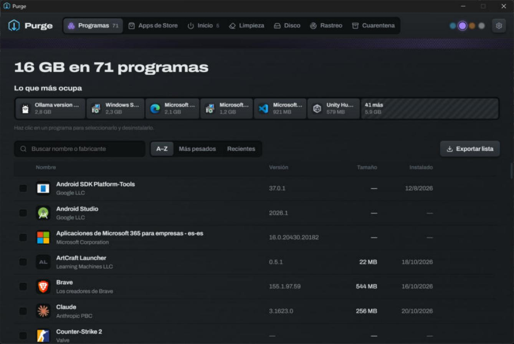
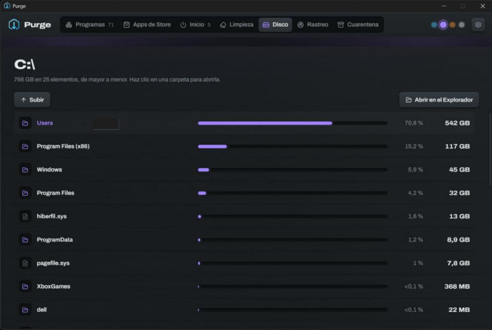

<p align="center">
  
</p>

<h1 align="center">Purge</h1>

<p align="center">
  A clean, modern uninstaller for Windows. Removes programs <b>and</b> everything they leave behind — safely.
</p>

<p align="center">
  <a href="https://github.com/bernaljeanp/purge/releases/latest"><b>⬇ Download for Windows</b></a>
  &nbsp;·&nbsp; ~2 MB &nbsp;·&nbsp; Windows 10 / 11 x64 &nbsp;·&nbsp; English / Español
</p>

<p align="center">
  
</p>

## What it does

- **Programs** — every installed program with its real icon, size, version and install date. See at a glance what takes the most space. Search, sort, export to CSV.
- **Uninstall + leftover scan** — runs each program's own uninstaller (one or many, optionally **silent**), then finds the folders and registry keys it left behind.
- **Quarantine, not delete** — leftovers are moved aside (registry exported to `.reg`) so every removal can be **restored**. Or delete permanently, your call.
- **Force remove** — for programs whose uninstaller is broken or missing; broken entries are flagged.
- **Orphaned folders** — finds folders left by programs you removed long ago.
- **Store apps** — list and remove Microsoft Store apps.
- **Startup** — turn apps that launch at sign-in on or off (the same switches Task Manager uses).
- **Cleaner** — temp files, crash dumps, error reports and DirectX / NVIDIA / AMD shader caches.
- **Disk** — a map of what fills each drive, folder by folder.
- **Install tracker** — snapshot before installing something, compare after, and keep a trace to remove *everything* it created later.
- **Right-click "Uninstall with Purge"** on any shortcut (optional).
- **Updates itself** and follows your Windows language.

<p align="center">
  
</p>

## Safety

Purge never touches Windows, its own scan roots, your user profile or vendor folders like `Microsoft` or `Common Files`. If a program still looks installed after its uninstaller ran, nothing is pre-selected. Everything you remove goes to quarantine first unless you choose *Delete permanently*.

> The installer isn't code-signed yet, so Windows SmartScreen may say *Windows protected your PC*. Click **More info → Run anyway**.

## Build from source

Requires Rust, Node 20+ and the [Tauri prerequisites](https://tauri.app/start/prerequisites/).

```bash
npm install
npm run tauri dev      # development (runs unelevated)
npm run tauri build    # installer (requests admin)
cd src-tauri && cargo test
node scripts/release.mjs "notes"   # signed release + auto-update manifest
```

Built with [Tauri 2](https://tauri.app) (Rust) and React.

## License

Apache-2.0. Leftover-detection ideas inspired by [Bulk Crap Uninstaller](https://github.com/BCUninstaller/Bulk-Crap-Uninstaller).
